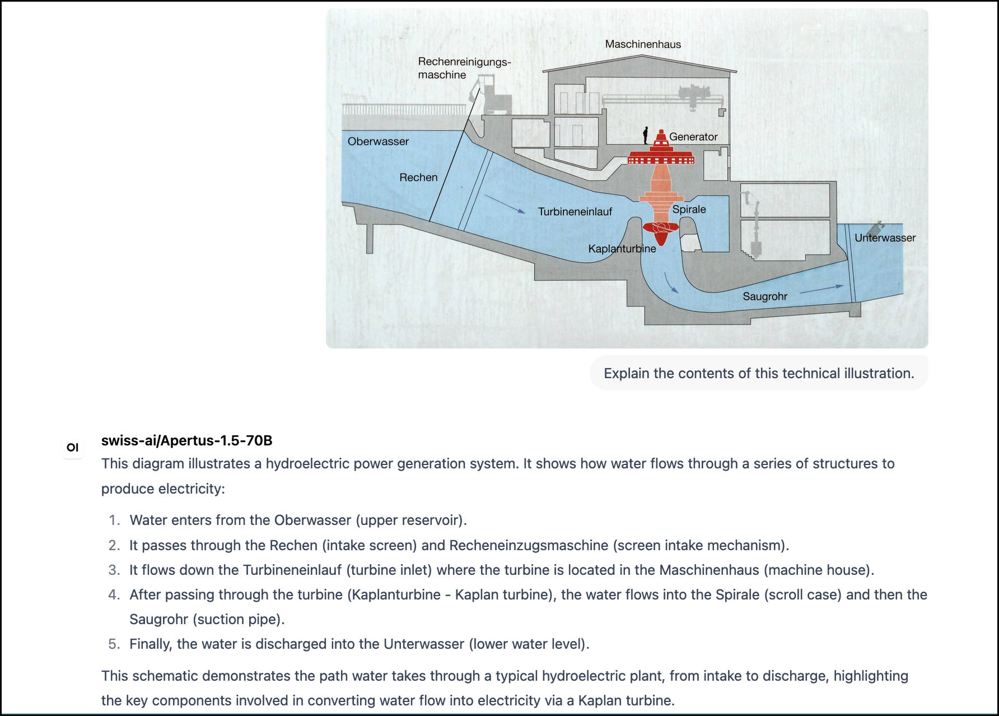

#### Our latest release, Apertus 1.5, extends the 8B and 70B Apertus 1.0 models with image understanding, an optional thinking mode, a four times longer context window, improved instruction-following, and better tool use. 

The updated [8B and 70B model weights](https://huggingface.co/collections/swiss-ai/apertus-v15) were released to Hugging Face on July 24, 2026 under an Apache 2.0 license. Further details are now available from the project [Technical Report](https://arxiv.org/abs/2610.15542), and summarized here. 

Apertus 1.5 is a continued pretraining of the first generation model: adding 4 trillion tokens of text and multimodal training data to the 8B model and 2 trillion tokens to the 70B model, for a total of 19T and 17T, respectively.  As with every Apertus release, the models are fully open: open [weights](https://huggingface.co/collections/swiss-ai/apertus-v15), open [data](https://github.com/swiss-ai/apertus-data-transparency/), open [values](/pages/charter/), and full training [details](/pages/research/).

_Screenshot of multimodal processing from developer testing: Apertus 1.5 70B interprets the contents of a technical drawing of a [Water power plant](https://commons.wikimedia.org/wiki/File:Wasserkraftwerks_Niederried-Radelfingen,_Schnittzeichnung.jpg) (CC BY 4.0) based on an image and short prompt. More screenshots can be found in a [Discussion thread](https://github.com/swiss-ai/www-apertus/discussions/66)._

## Key Enhancements

- *Native Multimodal Understanding:* Apertus 1.5 accepts images and audio alongside text, bringing documents, diagrams, and photos into the conversation. The models can also process spoken language, though this remains experimental.
- *Thinking Mode:* The models can be switched into a thinking mode to reason about the input before answering, which improves performance on reasoning problems.
- *Long Context:* The context window grows to 262,144 tokens, a 4x increase over Apertus 1.0.
- *Improved Instruction-Following:* Better instruction adherence than Apertus 1.0 gives more predictable and accurate responses.
- *Improved Tool Use:* The models are trained for better tool integration, allowing more effective use of external tools and APIs.
- *Open Values:* Stronger adherence to the Apertus Charter, which brings transparency to the model’s values and principles.

## Training Process

*The full Apertus 1.5 training pipeline*

### Multimodality Through the Tokenizer

We introduce multimodality in v1.5 models in an early-fusion manner, where images and audio enter Apertus as discrete tokens in the same sequence with text tokens, instead of using a separate vision encoder. Images are tokenized with the [Emu3.5](https://arxiv.org/abs/2510.26583) tokenizer (a 512×512 image becomes 1,024 tokens) and audio with [WavTokenizer](https://arxiv.org/abs/2408.16532) (40 tokens per second). We only extend the vocabulary, so the architecture stays unchanged and training runs at text-only speed. The models understand images and audio but generate only text.

### Pre-Training

Starting from Apertus 1.0, we continue pretraining in four stages:

1. **Unpaired:** text plus standalone images and audio, so the model learns the new modalities.
2. **Paired:** image–caption and audio–transcript pairs, so it aligns them with language.
3. **Cooldown:** higher-quality data with more math and code.
4. **Long context:** the window grows step by step from 8k to 262k tokens.

Overall, more than half of the training tokens are text-only, which preserves the language abilities of Apertus 1.0. The text data is refreshed with sources such as [FineWeb2-HQ+](https://huggingface.co/datasets/epfml/FineWeb2-HQ-Plus), FinePDFs, and Nemotron-CC. All new data, multimodal included, meets the same bar as before: publicly available, permissively licensed, and with robots.txt opt-outs respected retroactively. Every source is listed in [apertus-data-transparency](https://github.com/swiss-ai/apertus-data-transparency).

### Post-Training

Post-training runs in five stages: **SFT → long-context SFT → RL → DPO → charter alignment (SDPO)**.

1. **SFT** on 3.7M text samples plus image and speech data. Reasoning traces are added only to prompts the model can't already solve without them. Tool-use data is restricted to execution-verified trajectories. We release the [text SFT mix](https://huggingface.co/datasets/swiss-ai/Apertus-v1.5-SFT-mix) we used on Hugging Face.
2. **Long-context SFT** at the full 262k window restores the long-context ability that short-context SFT erodes.
3. **RL with verifiable rewards (RLVR)** on about 350k math, code, instruction-following, multilingual, and vision prompts, mixing thinking on and off. 
4. **DPO** with judge-scored preference pairs improves chat quality, tool use, and safety. We release the [preference pool](https://huggingface.co/datasets/swiss-ai/Apertus-v1.5-Preference-Pool) and [training pairs](https://huggingface.co/datasets/swiss-ai/Apertus-v1.5-Preference-Data).
5. **SDPO** aligns the model with the [Apertus Charter](/pages/charter/) through judge feedback and self-distillation. 

## Evaluation Results

Alongside the extended model capabilities, we also significantly expanded the scope of evaluations. Beyond the existing text-based evaluations used for Apertus 1.0, we added multimodal evaluations (image & audio), and thinking-mode evaluations. 

The multimodal evaluations are done through [MLLM-eval-suite](https://github.com/swiss-ai/MLLM-eval-suite) pipeline, merging two major multimodal evaluation frameworks [lmms-eval](https://github.com/swiss-ai/lmms-eval) and [VLMEvalKit](https://github.com/swiss-ai/VLMEvalKit). We also added a series of text-based benchmarks, as well as extended benchmarking for translation and multilingual capabilities, safety, and tool use. These can be found in our post-training [evaluation repository](https://github.com/swiss-ai/evals-post-train), based on [lm-evaluation-harness fork](https://github.com/swiss-ai/lm-evaluation-harness). 

While still trailing frontier open-weight models, the new release has also significantly improved performance in coding and instruction following capabilities with Apertus 1.5 8B outperforming similarly sized open-weight models on IF and multilingual tasks. Thinking further improves performance on challenging reasoning-heavy benchmarks like AIME. The multimodal performance of the model is closer to [Gemma 4 12B](https://deepmind.google/models/gemma/gemma-4/) and other current open-weight models. Apertus 1.5 multimodal performance is competitive in spatial understanding among open-weight models and document/chart understanding among open-source models. 

 We also thank our collaborators and external evaluators for their help with efficient benchmarking of Apertus capabilities. In particular, Apertus 1.5 shows strong performance on Swiss Legal tasks, being on par with leading open-weight models ([blog](https://github.com/JoelNiklaus/SwissLegalEvals/blob/main/blog/swiss-legal-evals-2026.md), [code](https://github.com/JoelNiklaus/SwissLegalEvals)). Additionally, on Last Translation Benchmark, Apertus 1.5 8B presents machine translation capabilities which match [GPT-OSS-20B](https://arxiv.org/abs/2508.10925) and outperform models like [Claude Haiku 4.5](https://www.anthropic.com/claude/haiku) or [Google Translate](https://translate.google.com) ([leaderboard](https://last-translation-benchmark.vilda.net/leaderboard-results), [paper](https://huggingface.co/papers/2609.04173)).

### Evaluation Cards: Apertus ❤️ EvalEval

Apertus collaborates with the [EvalEval Coalition](https://evalevalai.com) to ensure fully transparent and reproducible benchmarking. We publish the Apertus 1.5 results in the [Every Eval Ever (EEE)](https://github.com/evaleval/every_eval_ever) schema, a shared format that records not only scores, but also who ran the evaluation, how the model was accessed, the generation settings, and how each metric should be interpreted: details that are routinely missing from leaderboards and that often explain why similar-looking scores differ. 

The results are shown in the Eval Card below, which combines the run data with benchmark and model metadata into one interpretable record, and are also available through [Hugging Face Community Evals](https://huggingface.co/blog/eee-community-evals). This is the same infrastructure the [UK AI Security Institute uses to publish its evaluations openly](https://huggingface.co/blog/evaleval-aisi). Since our text evaluations run on our public fork of lm-evaluation-harness, which EEE supports with a dedicated converter, anyone can rerun them and compare their numbers against ours under identical settings. 

Structured evaluation reporting also matters beyond research. EvalEval has [mapped Evaluation Cards to AI governance requirements](https://evalevalai.com/infrastructure/2026/09/28/mapping-evaluation-cards-to-ai-governance-requirements/), including Article 55 of the EU AI Act and the GPAI Code of Practice, and found that the EEE schema can represent 56 of the 60 evaluation-reporting elements these frameworks call for. This fits how we already release Apertus: alongside the models, we publish a [Public Summary](https://github.com/swiss-ai/apertus-legal/raw/main/apertus_1.5/Apertus_1_5_EU_Public_Summary.pdf) of Training Content and, voluntarily, a [Code of Practice](https://raw.githubusercontent.com/swiss-ai/apertus-legal/main/apertus_1.5/Apertus_1_5_EU_Code_of_Practice.pdf) document. Machine-readable evaluation records are a natural next step: making it easier for regulators, deployers, and researchers to find, interpret, and compare the evidence behind a model. 

<iframe src="https://evaleval-general-eval-card.hf.space/embed/model/reported-metrics/swiss-ai/Apertus-v1.5-8B" width="100%" height="680" frameborder="0" style="border:1px solid #e5e5e5;border-radius:4px;" loading="lazy" title="Reported metrics"></iframe>

We are committed to promoting reproducible and transparent evaluation through Eval Cards and the EEE schema, and encourage other model developers to report their results in the same way, so that scores can be compared across models and organizations.

## Apertus 1.5 Reproducibility 

All recipes, ablations, and data mixtures are documented in the [Technical Report](https://arxiv.org/abs/2610.15542). We aim to popularize open model development by making the v1.5 training process public and accessible. Intermediate checkpoints are hosted in our **[Apertus 1.5 Hugging Face collection](https://huggingface.co/collections/swiss-ai/apertus-v15)**, including the base weights, SFT, RLVR and DPO, as well as our curated training data mixes/custom datasets in [Apertus 1.5 datasets collection](https://huggingface.co/collections/swiss-ai/apertus-v15-datasets). Sharing them allows researchers to investigate how each stage changes the model behavior.

The report covers numerous ablations on the effect of post-training data in different stages, where we observed that the multimodal data mixed in together with text data during SFT helps improve across all modalities. We also find that the benefits of multimodal reasoning traces survive the subsequent text-only reinforcement learning: starting from an SFT checkpoint trained with multimodal traces, RL improves mathematics more than when starting from a text-only checkpoint, and the advantage on reasoning tasks persists throughout training. 

| Models | 8B | 70B |
|---|---|---|
| Pre-training (long-context base) | [Apertus-v1.5-8B-base](https://huggingface.co/swiss-ai/Apertus-v1.5-8B-base) | [Apertus-v1.5-70B-base](https://huggingface.co/swiss-ai/Apertus-v1.5-70B-base) |
| Supervised finetuning (SFT) | [Apertus-v1.5-8B-SFT](https://huggingface.co/swiss-ai/Apertus-v1.5-8B-SFT) | [Apertus-v1.5-70B-SFT](https://huggingface.co/swiss-ai/Apertus-v1.5-70B-SFT) |
| Reinforcement learning (RLVR) | [Apertus-v1.5-8B-RLVR](https://huggingface.co/swiss-ai/Apertus-v1.5-8B-RLVR) | [Apertus-v1.5-70B-RLVR](https://huggingface.co/swiss-ai/Apertus-v1.5-70B-RLVR) |
| Preference alignment (DPO) | [Apertus-v1.5-8B-DPO](https://huggingface.co/swiss-ai/Apertus-v1.5-8B-DPO) | [**Apertus-v1.5-70B**](https://huggingface.co/swiss-ai/Apertus-v1.5-70B) (final) |
| Charter alignment (SDPO) | [**Apertus-v1.5-8B**](https://huggingface.co/swiss-ai/Apertus-v1.5-8B) (final) | – |

| Stage | Data | Code / recipe |
|---|---|---|
| **Pre-training: Stages 1–2** (unpaired, paired) | All sources with versions and licenses in [apertus-data-transparency](https://github.com/swiss-ai/apertus-data-transparency); vision and audio processing recipes in [multimodal-data](https://github.com/swiss-ai/multimodal-data) | [Megatron-LM](https://github.com/swiss-ai/Megatron-LM), launch scripts in [pretrain-code](https://github.com/swiss-ai/pretrain-code), [apertus-omni-tokenizer](https://github.com/swiss-ai/apertus-omni-tokenizer), [benchmark-image-tokenizer](https://github.com/swiss-ai/benchmark-image-tokenizer), [benchmark-audio-tokenizer](https://github.com/swiss-ai/benchmark-audio-tokenizer) (incl. interleaved speech–text builder) |
| **Pre-training: Stage 3** (cooldown) | [apertus-data-transparency](https://github.com/swiss-ai/apertus-data-transparency); curated image datasets [NASA](https://huggingface.co/datasets/swiss-ai/nasa), [Our World in Data](https://huggingface.co/datasets/swiss-ai/owid), [Smithsonian](https://huggingface.co/datasets/swiss-ai/smithsonian), [swisstopo](https://huggingface.co/datasets/swiss-ai/swisstopo) | [Megatron-LM](https://github.com/swiss-ai/Megatron-LM), launch scripts in [pretrain-code](https://github.com/swiss-ai/pretrain-code) |
| **Long-context extension** | [apertus-data-transparency](https://github.com/swiss-ai/apertus-data-transparency); synthetic long-context tasks in [LongContextQA](https://github.com/swiss-ai/LongContextQA) | [Megatron-LM](https://github.com/swiss-ai/Megatron-LM), launch scripts in [pretrain-code](https://github.com/swiss-ai/pretrain-code) |
| **SFT** | [Apertus-v1.5-SFT-mix](https://huggingface.co/datasets/swiss-ai/Apertus-v1.5-SFT-mix) (multimodal SFT mix listed in the report), [apertus-pretrain-romansh-backtranslated-sft](https://huggingface.co/datasets/swiss-ai/apertus-pretrain-romansh-backtranslated-sft) | [posttraining-data](https://github.com/swiss-ai/posttraining-data), [Megatron-LM](https://github.com/swiss-ai/Megatron-LM) (SFT launch scripts) |
| **Long-context SFT** | Subsets of the SFT mix (listed in the report), plus [LongContextQA](https://github.com/swiss-ai/LongContextQA) tasks | [Megatron-LM](https://github.com/swiss-ai/Megatron-LM) |
| **RL (RLVR)** | Mixture listed in the report | [verl](https://github.com/swiss-ai/verl), [verl-recipe](https://github.com/swiss-ai/verl-recipe) |
| **DPO** | [Apertus-v1.5-Preference-Pool](https://huggingface.co/datasets/swiss-ai/Apertus-v1.5-Preference-Pool) (annotated completions), [Apertus-v1.5-Preference-Data](https://huggingface.co/datasets/swiss-ai/Apertus-v1.5-Preference-Data) (pairs) | [posttraining](https://github.com/swiss-ai/posttraining), [verl](https://github.com/swiss-ai/verl) |
| **SDPO** (charter alignment, 8B only) | Prompts from third-party [gretelai/gretel-safety-alignment-en-v1](https://huggingface.co/datasets/gretelai/gretel-safety-alignment-en-v1) | [self-distillation](https://github.com/swiss-ai/self-distillation) |

## Model Availability

[Proton Lumo](https://proton.me/support/apertus-lumo) and [Infomaniak Euria](https://www.infomaniak.com/en/support/faq/2924/discover-euria-and-the-apertus-model) are two widely used apps that have recently integrated Apertus 1.5. These deployments are linked in the **[Community Showcase](/pages/get-showcase/)** among others - see this [discussion thread](https://github.com/swiss-ai/www-apertus/discussions/66) for a preview. 

Access to Apertus 1.5 in the form of an API for developers has been announced by a range of providers, including [Swisscom](https://docs.cloud.swisscom.ch/guide/cloud-services/aip/models/apertus-1_5_70B), [Infomaniak](https://www.infomaniak.com/en/hosting/ai-services/open-source-models), [Phoeniqs](https://documentation.kvant.cloud/maas/active-models/), and other companies listed in our **[General Availability guide](/articles/2026-09-apertus-1-5-ga/)**. The report also provides details on how we work with external evaluators to test and prepare the models.

Technical instructions for running the models are in the model cards of the Apertus releases on Hugging Face and in our **[Quickstart guide](/docs/quickstart/)**.

## How to Get Involved

Thank you for reading this blog post and being part of our community! We just celebrated five million downloads in our Hugging Face analytics 🤗 and are not slowing down. At the recent [AI+X Summit](https://plusx.ai) in Zurich, our team announced the roadmap for **Apertus 2.0**: sparse/MoE architecture, ~600B total parameters, extended training schedule, with agents, mathematics and coding as priorities.

In summary: we invite you to read our report, download the models, explore the intermediate checkpoints, finetune the weights, and reproduce our evaluations. Questions that are not already covered in [our publications](/pages/research/) or [website FAQ](/docs/faq/) are always welcome, and we would also love to hear which topics would be most useful to the community for future deep dives.

If you build with or use Apertus, please fill out the [Showcase form](/showcase/), and reach out through the options on our [Contact page](/contact/). We are looking forward to highlighting more work, learning what you are building, and hearing how Apertus can be improved!

### Citation

> Apertus Project, et al. “Apertus 1.5: From Open Text Models to Open Multimodal Reasoners.” arXiv:2610.15542. Preprint, arXiv, October 11, 2026. https://doi.org/10.48550/arXiv.2610.15542.

### Online Coverage

- [Apertus 1.5: Building the next generation of open AI infrastructure](https://actu.epfl.ch/news/apertus-15-building-the-next-generation-of-open--2/) - EPFL - 24.7.2026
- [Apertus 1.5: Building the next generation of open AI infrastructure](https://ai.ethz.ch/news-and-events/ai-center-news/2026/07/apertus-15-building-the-next-generation-of-open-ai-infrastructure.html) - ETH Zurich - 24.7.2026
- [Apertus 1.5: Building the next generation of open AI infrastructure](https://www.cscs.ch/science/computer-science-hpc/2026/apertus-15-building-the-next-generation-of-open-ai-infrastructure) - CSCS - 24.7.2026
- [With 1.5x the love, from Switzerland](https://publicai.co/stories/apertus-1-5) - Public AI - 24.7.2026
- [IA: l’EPFL et l’ETH Zurich lancent le modèle Apertus 1.5](https://www.xavierstuder.com/2026/07/apertus-1-5-llm-ia-intelligence-artificielle-epfl-eth-zurich/) - Xavier Studer - 25.7.2026
- [Schweizer KI Apertus bekommt Update](https://www.inside-it.ch/schweizer-ki-apertus-bekommt-update-20260727) - inside-it.ch - 27.7.2026
- [LLM Benchmark Evaluation - Apertus 1.5-8B](https://blog.nlp-lab.ai/2026/07/29/Apertus15Bench.html) - DS-NLP Lab - 29.7.2026
- [Apertus 1.5 : l’IA souveraine suisse lance sa nouvelle version](https://dcod.ch/2026/07/31/apertus-1-5-ia-souveraine-suisse/) - Marc Barbezat - 31.7.2026
- [Run Apertus v1.5 70B on a single NVIDIA RTX 6000](https://www.onprem.ai/en/knowhow/run-apertus-v15-70b-single-nvidia-rtx-6000/) - onprem.ai - 3.8.2026
- [The State of the Art in Open Source AI for Swiss Legal Tasks](https://github.com/JoelNiklaus/SwissLegalEvals/blob/main/blog/swiss-legal-evals-2026.md#the-state-of-the-art-in-open-source-ai-for-swiss-legal-tasks) - Joel Niklaus - 4.8.2026
- [Helvetra moves to Apertus 1.5: what changes, and what we're watching](https://www.helvetra.ch/news/apertus-1-5-what-it-means-for-helvetra) - 4.8.2026
- [Shrinking Apertus 1.5 8B for an 8 GB Laptop GPU](https://digitalpathlines.ch/2026/08/12/shrinking-apertus-1-5-8b-for-an-8-gb-laptop-gpu/) - Emmanuel Belo - 12.8.2026
- [Apertus 1.5 - first impressions from using Switzerland’s updated AI model](https://www.liip.ch/en/blog/apertus-1-5-first-impressions-from-using-switzerland-s-updated-ai-model) - Josef Kruckenberg - 26.8.2026
- [A year after its launch, it is time to take stock of Switzerland’s AI model Apertus](https://www.swissinfo.ch/eng/swiss-ai/one-year-on-has-swiss-ai-model-apertus-lived-up-to-the-hype/91984276) - Sara Ibrahim - 2.9.2026

#### \* * * * *

Please contact us if you would like to see your review listed here.
For updates and further information, subscribe to our [Inside Apertus newsletter](/subscribe).
